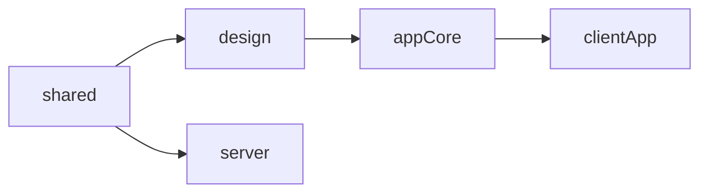
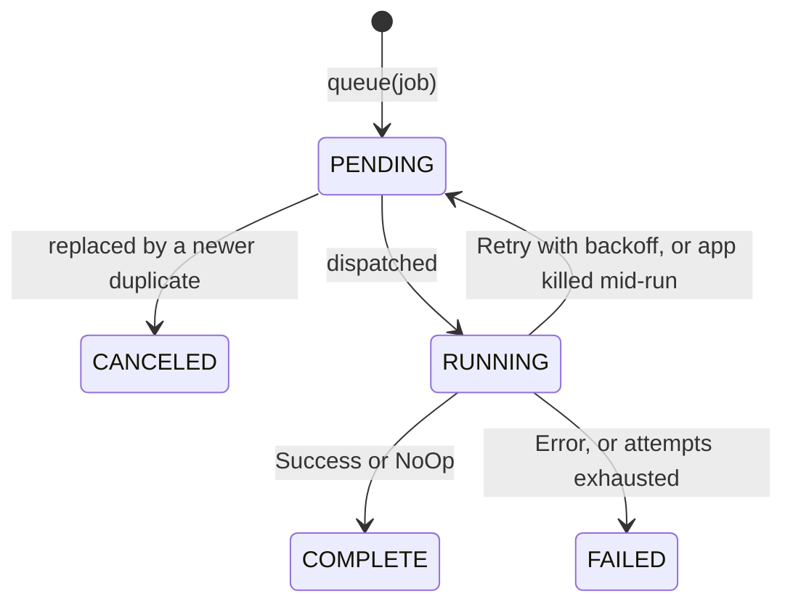
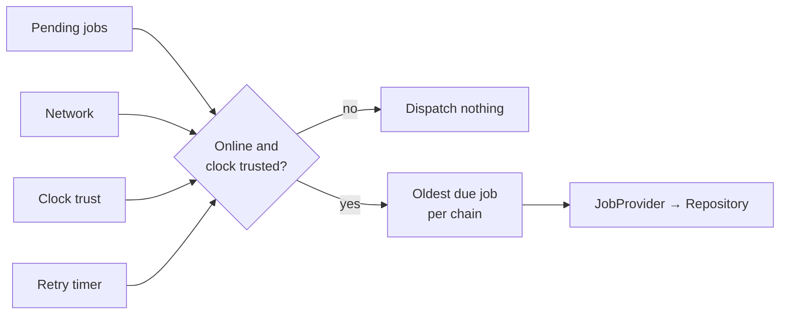
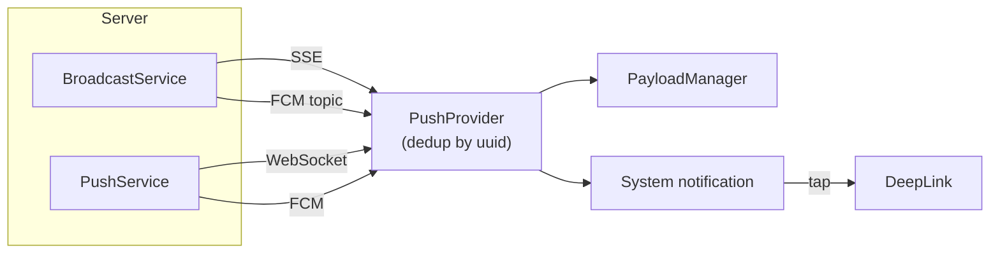

# App Builder

A ready-to-go, **offline-first Compose Multiplatform** starter kit for building full-stack apps fast.
Everything is pre-wired, so you can skip the boilerplate and ship to every platform from a single codebase.

| Area                                                          | What you get                                                                                      |
|---------------------------------------------------------------|---------------------------------------------------------------------------------------------------|
| **[Kotlin Multiplatform](#how-it-works)**                     | One Compose Multiplatform client for Android, iOS, Windows, macOS, Linux and Web.                 |
| **[Offline-first](#offline-engine)**                          | A persistent job queue with per-entity chains, backoff and zombie recovery.                       |
| **[Sync correctness](#delta-sync)**                           | Keyset-paginated delta sync, with push routed through the job scheduler.                          |
| **[Distributed time](#clock-trust)**                          | Detection of untrustworthy device clocks from NTP-style offset measurements and OS clock changes. |
| **[Real-time delivery](#push-notifications)**                 | FCM, WebSocket and SSE push merged into one de-duplicated stream.                                 |
| **[Backend and scaling](#multi-instance-scaling)**            | A Ktor server with no per-instance state, coordinated through a pluggable cross-instance signal.  |
| **[Security](#cryptography)**                                 | Encryption backed by each platform's native cryptography.                                         |
| **[Accounts and sessions](#accounts--sessions)**              | Accounts, sessions and per-entity permissions.                                                    |
| **[Design system](#design-system--showcase)**                 | A configurable design system with an in-app catalog of every component.                           |
| **[Translations](#translations)**                             | Server-served translations that update live, with a bundled offline fallback.                     |
| **[Feature flags](#feature-flags--remote-configs)**           | Typed flags and remote configs shared by client and server, with no third-party service.          |
| **[Telemetry](#telemetry-hub)**                               | One logging API fanning out to pluggable engines, so any telemetry service can be added.          |
| **[UI architecture](#ui-store--navigation)**                  | An MVI Store plus Navigation scene strategies.                                                    |
| **[Testing](#testing)**                                       | Unit, UI and server tests from one hermetic harness.                                              |
| **[Build and release](#versioning--release-builds)**          | Convention plugins, one-command version bumps and notarised desktop packaging.                    |

> [!IMPORTANT]
> The project is licensed **AGPL-3.0**. Derivative works must be distributed under the same license with source available, and that applies to network services too, not just distributed binaries.
> If that doesn't suit you, it still works as a reference architecture. See [License](#license).

## Contents

1. [Getting Started](#getting-started)
2. [How It Works](#how-it-works)
3. [Offline Engine](#offline-engine)
4. [Push Notifications](#push-notifications)
5. [Development Guide](#development-guide)
6. [Configuration & Deployment](#configuration--deployment)
7. [Noteworthy Code](#noteworthy-code)
8. [Reference](#reference)
9. [FAQ](#faq)
10. [About](#about)

# Getting Started

Everything below works with zero configuration: no Firebase project, no Postgres, no env vars, no `local.properties`.

**Prerequisites**

* **JDK 21.** Gradle comes from the wrapper, but no toolchain resolver is configured, so Gradle will not download a JDK for you.
* **Android**: the Android SDK.
* **iOS**: Xcode and CocoaPods (`brew install cocoapods`).
* **Desktop and Web**: nothing else.

**Run it**

1. **Start the server**: `./gradlew :server:run`. It boots on `http://localhost:8080` with a full dev environment, including an admin account.
2. **Run a client**. Dev builds target `http://localhost:8080` automatically.

   | Target  | Command                                                         |
   |---------|-----------------------------------------------------------------|
   | Desktop | `./gradlew :clientApp:run`                                      |
   | Web     | `./gradlew :clientApp:wasmJsBrowserDevelopmentRun`              |
   | Android | `./gradlew :clientApp:installDebug`                             |
   | iOS     | `cd iosApp && pod install`, then open `iosApp.xcworkspace`      |

3. **Log in** with `admin`/`admin`. The account is seeded with all permissions, so it can create further accounts from inside the app.

`.run/` holds shared IDE run configurations for all four clients and for every test suite, so each command above has a click-to-run equivalent.

<details>
<summary>What is pre-wired, and what breaks if you change only one half of it</summary>

* The server port falls back to the same `URL.DEV_PORT` constant the client's `URL.DEV_HOST` is built from, so both sides agree on `8080` by construction.
* The web dev server's `8010` is in the server's development CORS allowlist. Change the port and browser API calls start failing CORS.
* Both CocoaPods podspecs are committed, so `pod install` resolves on a fresh clone without running a Gradle task first. It also pulls the `FirebaseCore` and `FirebaseMessaging` pods, so the first run needs a network connection.

</details>

# How It Works

A **Kotlin Multiplatform** project following a **layered Clean Architecture** with a **unidirectional dependency flow**.

## Platforms & Tech Stack

| Source Set    | Platform                       |
|---------------|--------------------------------|
| `commonMain`  | All                            |
| `androidMain` | Android API 26+                |
| `appleMain`   | iOS 16+                        |
| `desktopMain` | JVM 21 (Windows, macOS, Linux) |
| `webMain`     | WASM-JS                        |
| `server`      | JVM 21                         |

* **UI**: [Compose Multiplatform](https://github.com/JetBrains/compose-multiplatform)
* **Client database**: [SQLDelight](https://sqldelight.github.io/sqldelight)
* **Server database**: [Exposed](https://www.jetbrains.com/exposed/)
* **Networking**: [Ktor](https://ktor.io/)
* **Code coverage**: [Kover](https://github.com/Kotlin/kotlinx-kover)

## Modules

| Module        | Purpose                                                                                            |
|---------------|----------------------------------------------------------------------------------------------------|
| `shared`      | Code reused by every target, client and server: domain models, flags, the HTTP registry.           |
| `sharedTest`  | Test fixtures, base test cases and mocks reused by every other module's tests.                     |
| `design`      | The design system: every UI component, each with its own showcase.                                 |
| `appCore`     | Reusable Compose Multiplatform app infrastructure: offline engine, push, media, navigation.        |
| `clientApp`   | The end-user app for Android, iOS, Desktop and Web.                                                |
| `server`      | The Ktor backend.                                                                                  |
| `build-logic` | App identity, versions, target configuration and build-time code generation, as a composite build. |

Production dependencies form a single graph with `shared` at the bottom and nothing ever pointing back up.
Arrows point from a module to the modules that use it:



`sharedTest` sits outside that graph: every other module pulls it in from its own `commonTest`.

## Layers

Every module uses the same packages, and dependencies only point down the stack:

| Package  | Responsibility                                                    | May depend on               |
|----------|-------------------------------------------------------------------|-----------------------------|
| `core`   | Business-agnostic foundations: platform APIs, security, telemetry | nothing                     |
| `data`   | Persistence and retrieval: network, database, storage             | `core`                      |
| `domain` | Business workflows, rules and the domain models                   | `data`, `core`              |
| `ui`     | Presentation                                                      | `domain`, `data`, `core`    |
| `test`   | Annotations and fake data shared across test source sets          | all of the above            |

Not every module has every package. See [Package Index](#package-index) and [Module Index](#module-index) for the full breakdown.

## Dependency Injection

Dependencies are wired by hand. KMP support in popular DI frameworks adds complexity and limitations on every target, and generated code is especially troublesome on WASM.

* **Client**: `Dependency.AppGraph` holds everything that exists before login (`SqlDriver` → `AppDatabase`, `HttpClient`, `Scheduler`, push and translation services, a default guest user). `Dependency.UserGraph` is built per authenticated user on top of it, cached by user uuid, so switching accounts swaps only the authenticated half.
* **Server**: `Dependency` receives an already-built `R2dbcDatabase` and wires the `UseCases` through `Gateways`.

# Offline Engine

The offline engine is what makes the app offline-first: a persistent, fault-tolerant job queue in the database that keeps background work safe while connectivity is down, and resumes on its own when it returns.

Every background operation is modeled as a `Job` before it touches the network:



## Lifecycle of an Offline Edit

1. **Optimistic local write**: the entity is saved to SQLite in one transaction. Screens only render database flows, so the UI updates instantly.
2. **Enqueue**: a `Job(entityType, type = POST, entityUuid)` is queued, the [conflict policy](#conflict-policies) is applied, and it is persisted as `PENDING`.
3. **Gating**: nothing dispatches while the device is offline or its [clock is untrusted](#clock-trust). No work is lost.
4. **Dispatch**: once both gates open, the oldest job in its [chain](#chains) is marked `RUNNING` and resolved by `JobProvider` into the feature's `Repository` call.
5. **Execution**: the repository `POST`s the entity. The server's copy is merged back only if `remote.modifiedAt >= local.modifiedAt`, and the job becomes `COMPLETE`.
6. **Release**: the chain is freed and the terminal state written inside a `NonCancellable` block, so a shutdown mid-flight cannot strand the chain.
7. **Read-back**: the UI recomposes from the database. Any background `GET` sync for that entity type waits until every pending mutation has been pushed.

## Job

| Property         | Meaning                                                                                   |
|------------------|-------------------------------------------------------------------------------------------|
| `uuid`           | The job's own identity and primary key.                                                   |
| `userUuid`       | The user that created it. Part of the chain key, so two accounts never block each other.  |
| `utc`            | Creation time, and the ordering key: within a chain the oldest job runs first.            |
| `entityType`     | The domain entity the job operates on.                                                    |
| `entityUuid`     | The specific entity, or `null` for a whole-collection sync.                               |
| `type`           | `GET`, `POST` or `DELETE`.                                                                |
| `conflictPolicy` | How to treat duplicates. Defaults to `IGNORE` for `GET` and `APPEND` for `POST`/`DELETE`. |
| `payload`        | JSON execution parameters.                                                                |
| `state`          | `PENDING` → `RUNNING` → `COMPLETE` / `FAILED` / `CANCELED`.                               |
| `attempt`        | Zero-indexed retry counter.                                                               |
| `nextAttemptAt`  | Earliest time a retried job may run again.                                                |

## Conflict Policies

Applied when a job is queued, before anything is written:

| Policy    | Behaviour                                                | Default for       |
|-----------|----------------------------------------------------------|-------------------|
| `APPEND`  | Enqueue alongside any pending duplicates                 | `POST`, `DELETE`  |
| `REPLACE` | Cancel pending duplicates, then enqueue                  | —                 |
| `IGNORE`  | Drop the new job if a duplicate is already pending       | `GET`             |

Two jobs are **duplicates** when they share `userUuid`, `entityType`, `entityUuid` and `type`, and the existing one is still `PENDING`. **`payload` is not compared.**

* A `GET` means "bring me up to date", so extra syncs collapse into the one already waiting, which pulls whatever is newest when it runs.
* A `POST` or `DELETE` carries a distinct user intent, so collapsing two would silently drop an edit. `APPEND` keeps both and replays them in order.
* `REPLACE` is for last-write-wins work, where only the final state matters.

> [!TIP]
> If two `GET`s for the same entity type need different parameters, use `APPEND`: `IGNORE` would discard the second.

## Chains

Jobs are grouped into **chains** keyed by `(userUuid, entityType, entityUuid)`.
Only the oldest pending job in a chain runs at a time, so mutations to one entity stay in order while unrelated entities run in parallel.
If that oldest job is waiting out a retry backoff, the whole chain waits with it.

There are two kinds of job:

* **Targeted** (`entityUuid != null`): a `POST`, `DELETE`, or the `GET` of a push-triggered sync on one entity.
* **Global** (`entityUuid == null`): a full collection sync that reads and rewrites the whole table.

They are **mutually exclusive per entity type**, in both directions:

* A global sync won't start while any targeted job for that type is pending or running, so a pull can never overwrite a local write that hasn't been pushed.
* A targeted job won't start while a global sync for that type is active, so a mutation never interleaves with a half-applied bulk read.

Per `(user, entityType)`, the engine is doing either one full sync or any number of per-entity chains, never both. Different entity types proceed in parallel.

<details>
<summary>Why the active chains are also tracked in memory</summary>

The dispatch loop is reactive: a new database emission can arrive while earlier jobs are still running.
A mutex-guarded in-memory `activeChains` set stops the loop from dispatching the same chain twice.

</details>

## Dispatch Gating



The scheduler combines four streams. When a gate is closed it substitutes an empty list instead of stopping, so the loop stays subscribed and resumes the moment any source emits again.
A database read failure also becomes an empty emission, so a transient storage error costs one idle tick rather than the scheduler.

### Clock Trust

`ClockService` answers one question as a `StateFlow<Boolean>`: can the device clock be trusted? Three signals feed it:

* An **NTP-style offset**, recalculated from the round trip of every successful HTTP response and compared against `clockDriftTolerance`.
* **OS clock-change notifications**, which revoke trust as soon as the clock is changed.
* A **probe loop** that runs only while trust is lost, re-measuring until the offset is back within tolerance.

While trust is lost, nothing dispatches: a device with a wrong clock must not arbitrate `modifiedAt`-based conflict resolution against other devices.

> [!NOTE]
> This is still a trust-based system. It catches drifting and changed clocks, not a client that has been tampered with to lie.

## Retry & Failure Handling

Each execution returns a `JobResult`:

| Result             | Outcome                                                                                       |
|--------------------|-----------------------------------------------------------------------------------------------|
| `Success` / `NoOp` | `COMPLETE`                                                                                    |
| `Retry`            | Back to `PENDING` with a backoff deadline, or `FAILED` once `schedulerMaxAttempts` is reached |
| `Error`            | `FAILED`                                                                                      |

`Throwable.toJobResult()` decides which failures are retryable. A failure is **transient** if the same job can succeed unchanged later:
`InternetDisabledException`, any `IOException` (timeouts, dropped connections), and `408`, `429` or `5xx` responses.
Validation, permission and serialization failures would fail identically every time, so they are terminal. Retrying a request that may already have reached the server is safe because upserts are idempotent.

**Backoff** starts at `schedulerRetryDelay` and doubles each attempt up to `schedulerMaxRetryDelay`. The loop skips jobs that aren't due yet and arms a single timer for the earliest one.

<details>
<summary>Edge cases of a backed-off job</summary>

* It still counts as pending for the sync exclusion, so a mutation awaiting retry keeps holding back a full sync of its entity type.
* It still counts as pending for the conflict policy, so while a `GET` backs off, `IGNORE` drops identical `GET`s such as a manual refresh. Nothing is lost, but the refresh lands at the deadline instead of immediately.
* A deadline further ahead than `schedulerMaxRetryDelay` can only come from a changed device clock, so such a job is treated as due immediately.
* If connectivity returns before the deadline, the job still waits out the remainder.

</details>

**Safety properties**

* **Failure is the default.** Before running, the job is staged as `FAILED`, and only an explicit result overwrites that. An escaped exception lands on `FAILED`, never on a stuck `RUNNING` that would block the queue forever.
* **Terminal writes are non-cancellable.** If the scheduler is cancelled mid-execution, the chain is still released. A job still executing is deliberately left `RUNNING` so zombie recovery requeues it.

## Zombie Recovery

`RUNNING` is a claim held in the database, but the coroutine holding it lives only in memory. If the OS kills the app mid-run, the job would look claimed forever.

On every startup, before the dispatch loop subscribes, every `RUNNING` row is reset to `PENDING` in one statement. It is safe precisely because no worker exists yet.
The cost is that a job killed after reaching the server runs twice, which is harmless: upserts are keyed by entity uuid and guarded by the `modifiedAt` comparison.

## Delta Sync

Two complementary paths keep the local database current:

* **Collection sync**: periodically catches a device up on everything it missed.
* **Push-triggered entity sync**: fetches a single entity as soon as the device is told it changed.

Both write through the same `modifiedAt`-guarded upsert, so an older copy can never overwrite a newer local one.

### Collection Sync

A paginated fetch shaped by two independent bounds:

* A fixed **watermark** (`last_sync_utc`): everything before it is already synced. It never moves during a sync.
* A walking **keyset cursor** (`cursor_utc`, `cursor_uuid`), taken from the last row of each page.

The server orders by `modifiedAt DESC, uuid DESC`. The uuid is a tiebreaker: rows written in the same instant would otherwise have no stable order, and the cursor could skip or repeat rows at a page boundary.
Newest-first means the freshest changes arrive in the very first page of a large backlog. The page size is clamped server-side.

Each page is committed in its own transaction before the next is requested, and paging stops on the first short page.

The new watermark is **captured before the first request** and **persisted only after every page succeeds**.
Capturing it afterwards would let a write landing mid-sync fall between the old and new watermark and be skipped forever; capturing it up front only risks re-fetching a row.
If any page fails, the watermark is left untouched and the next attempt restarts from the last known-good point.

A missing `READ` permission is checked before the request and is a terminal failure.

### Push-Triggered Entity Sync

1. When an entity is upserted, the server sends a `PushPayload.EntityNotification` carrying its `entityType` and `entityUuid`. A plain `PushPayload.Notification` triggers no sync.
2. The client shows the notification, then queues a targeted `GET` job for that entity.
3. The scheduler runs it with the usual chain rules and gating, fetching `GET /api/{feature}/{uuid}`.

Routing through the scheduler means a push received offline becomes a persisted job instead of a missed update.
And because the payload is only a *signal* to re-fetch, never the data itself, an out-of-order, duplicated or stale push cannot corrupt local state.

The follow-up fetch is gated by the `pushSync` flag, separately from `push`, so notifications can stay visible without the background re-fetch.

## Turning the Engine Off

* **`scheduler` flag disabled**: `queue(job)` stops queueing and runs the job immediately on a background coroutine. Everything still executes, but eagerly, once, with no persistence, retries, ordering or gating. Work issued offline simply fails. Useful for debugging a misbehaving queue, or for a build with no offline requirement.
* **Running fully disconnected**: swap `HttpClientEngine` for `NoOpHttpClientEngine` (answers every request with `204`), or disable the `http` client flag (every request fails immediately). The first exercises the success path, the second the failure path. Neither keeps the engine useful: the no-op engine's responses carry no server time, so the clock is never trusted and jobs wait forever, while the disabled flag fails every job.

# Push Notifications

Two server services each deliver over two channels, and the client merges everything into one stream:



* **Broadcast** (`BroadcastService`) sends to every listener, over the SSE stream and the FCM broadcast topic.
* **Push** (`PushService`) sends to one user's devices: over their live WebSocket connections, and over FCM to devices that have none.

## Delivery Guarantees

* **Direct sends** (`POST /api/push`) are best-effort. If a WebSocket send fails after the FCM exclusion list was computed, that one notification can be missed until the next one triggers a fresh presence check.
* **Entity-triggered notifications** are durable. `NotificationsGateway.saveNotification` persists the payload to `NotificationTable` before delivery, `PushManager` observes that table per user and redelivers on every change, and a row is deleted only when the client acknowledges it. A device that reconnects gets its whole unacknowledged backlog: **at-least-once** delivery.

Duplicates are dropped client-side. `PushProvider` keeps a mutex-guarded ring of recently handled payload uuids, capped at `maxHandledPayloads`.
A bounded ring is enough because it only needs to span the gap between the same payload arriving over FCM and over the socket; a set that remembered every uuid would leak for the lifetime of the process.

<details>
<summary>Why not fall back to FCM when a WebSocket send fails?</summary>

It would mean computing the exclusion list up front, then coordinating concurrent per-device sends to re-send only the failed subset in one batched FCM call.
The narrower gap is accepted instead, because the [client lifecycle](#client-connection-lifecycle) only keeps a socket open while the OS says the app is reachable, so failures are rare and short-lived.
If you ever keep sockets alive longer in the background on some platform, revisit this trade-off.

</details>

## Client Side

* `PushManager` mints a single-use ticket, opens the WebSocket and reconnects with exponential backoff, gated on network availability so a dead network does not spin the loop.
* `BroadcastManager` does the same for the SSE stream, without a ticket since broadcasts are not user-scoped.
* `PushProvider` emits every payload on a single `pushPayloads` flow, collected by the client's `PayloadManager`. `NotificationProvider.showNotification` renders the native notification, and a tap becomes a `DeepLink` for the navigation layer.

## Client Connection Lifecycle

`RegisterPushLifecycle` and `RegisterBroadcastLifecycle` decide what happens to the WebSocket and SSE connections when the app is backgrounded:

| Platform          | In the background                            | Why                                                                                                                                                                       |
|-------------------|----------------------------------------------|---------------------------------------------------------------------------------------------------------------------------------------------------------------------------|
| **Android / iOS** | Connections close; FCM is the only channel   | The OS suspends idle sockets soon after backgrounding anyway (Doze, iOS limits). FCM/APNs exist to wake a backgrounded or killed app, at far lower battery and data cost. |
| **Web**           | Connections stay open while the tab is open  | An FCM service worker covers background delivery.                                                                                                                         |
| **Desktop**       | Connections stay open for the app's lifetime | There is no FCM client SDK for JVM desktop apps, so Desktop never registers a token. Notifications still render through the AWT `SystemTray`.                             |

## Multi-Instance Scaling

The server holds no state that only one instance can see, so it runs correctly behind any number of instances.
A ticket request and its WebSocket upgrade can land on different instances, and a notification can be sent from an instance holding none of the recipient's sockets.

* **Connection tickets** (`TicketTable`): persisted, not held in memory, so a ticket minted by one instance is redeemable on any other. Consumption is atomic, so a ticket can never be redeemed twice.
* **Connection presence** (`ConnectionTable`): which device is connected to which instance lives in the database. Each instance heartbeats its own rows and sweeps rows left by crashed instances, so the "skip FCM, it's connected" decision is correct globally.
* **Cross-instance signaling** (`InstanceSignal`): a `notify`/`observe` abstraction that wakes the instance holding the socket. Production uses `PostgresSignal` (`LISTEN`/`NOTIFY`), with one shared self-healing connection per channel and a separate connection for publishing; development uses the in-process `LocalSignal`. An instance delivers to its own SSE sessions directly and skips its own echo, so a signal failure never blacks out the sessions it holds.

Signals are fire-and-forget. Anything that must survive a missed delivery, like the notification or connection presence, is already in the database.

> [!IMPORTANT]
> **Device ownership.** `deviceUuid` comes from a request header, so the client picks it. Every per-device table is therefore keyed on `(userUuid, deviceUuid)`, never on `deviceUuid` alone, or one account could claim another's row and hijack or kill its push delivery. New per-device tables must follow the same rule.
> The one exception is moving an FCM token between users on a shared device, matched on the token alone because it is the only value an attacker cannot guess.

<details>
<summary>Why Postgres <code>LISTEN</code>/<code>NOTIFY</code> instead of Redis or a message broker?</summary>

The project already requires Postgres, so `LISTEN`/`NOTIFY` covers "wake whichever instance holds this socket" without another piece of infrastructure to run, monitor and pay for.
If you outgrow it (very high fan-out, cross-region, durable ordered delivery), that is when a real broker earns its keep.

</details>

# Development Guide

## Adding a Feature

Gate every new feature behind a flag, and give it the flag before its first screen.

**Shared**

1. Add the domain model(s) to the `domain` package.
2. Add the entity to `EntityType` for offline support.
3. Add the client and server flags: `val {feature}: Boolean`.

**Design**

1. Add the UI components it needs.

**Client App**

1. **Components**: `ui/component/{component}` with `{Component}`, `{Component}StateAction` and `{Component}Store`.
2. **Screen**: `ui/screen/{feature}` with `{Feature}Screen`, `{Feature}ScreenStateAction` and `{Feature}ScreenStore`.
3. **Gateway**: `domain/gateway/{feature}` with a `{Feature}Gateway` implementing `{Feature}UseCases` and/or `{Feature}Repository`, a `Mappers` file between the domain model and the SQLDelight schema, and the `.sq` files under `sqldelight`. Register it in `Gateways`, and its interfaces in `UseCases` and/or `Repositories`.
4. **Scheduler**: handle the entity in `domain/scheduler/JobProvider`, which switches on `EntityType` and `Job.Type` and delegates to the feature's **`Repository`**.
5. **Navigation**: add the screen to `Screen`, its route to the `provider` package, and link it in `Navigation`, gated by the flag.

**Server**

1. **Database**: add the table to `data/database/table` and to the table list in `Database`.
2. **Use cases**: add them to `domain/usecase` and register them in `UseCases` and `Gateways`.
3. **Routes**: add them to `domain/route/provider` and link them in `Routing`, gated by the flag. Validate access and log request telemetry.

### UseCases vs Repositories

They are not "domain logic" vs "data access". They are two consumer contracts on the **same** gateway:

* **`UseCases`**: the UI-facing write API, used by screens. Writing through it enqueues jobs.
* **`Repository`**: the read/sync API, used by other gateways and the scheduler. Going through `UseCases` from the scheduler would re-enqueue work and loop.

Each consumer gets the narrowest surface it needs, while one concrete gateway per feature avoids duplicated implementation or state.

### Sharing Models with the Server

Domain models in `shared` are `@Serializable` and sent over the wire as-is, with no DTO layer.
The only mapping is to each side's persistence schema, kept next to the feature: the gateway's `Mappers.kt` on the client, the `Exposed` table on the server.
Adding a field is one change in `shared` plus the two mappers that persist it.

## Registries

Every resource, endpoint and screen has one registry that owns it, and code uses the registry entry instead of a raw string.
Adding something is a compile-time change in one known place, and removing it breaks the build instead of failing at runtime.

**Assets** (sealed classes carrying the relative path)

| Type        | Drop the file in                                     | Register it in                | Read it with                             |
|-------------|------------------------------------------------------|-------------------------------|------------------------------------------|
| Audio track | `clientApp/src/commonMain/resources/tracks`          | `data/resource/AudioResource` | `AudioPlayer`                            |
| Image       | `clientApp/src/commonMain/composeResources/drawable` | `data/resource/ImageResource` | `ImageResource.X.drawable`               |
| JSON file   | `clientApp/src/commonMain/composeResources/files`    | `data/resource/JsonResource`  | `loadResource<T>(json = JsonResource.X)` |

**Everything else**

| Adding            | Register it in                                                                                                      |
|-------------------|---------------------------------------------------------------------------------------------------------------------|
| Entity type       | `shared/domain/EntityType` (required by the offline engine)                                                         |
| Endpoint          | `shared/data/http/URL`                                                                                              |
| HTTP header       | `shared/data/http/Header`                                                                                           |
| Query parameter   | `shared/data/http/Query`                                                                                            |
| Push payload type | `shared/domain/PushPayload`, then handle it in `clientApp/domain/push/PayloadManager`                               |
| Feature toggle    | `ClientFlags` and `ServerFlags`                                                                                     |
| Tunable value     | `ClientConfigs` and `ServerConfigs`                                                                                 |
| Translation       | `main/resources/static/translations.json`, mirrored in `composeResources/files/translations.json`                   |
| Persisted file    | A `StorageFile` in `CoreFile` (`appCore`) or `AppFile` (`clientApp`), plus that index's `all` list                  |
| Screen            | `ui/navigation/Screen` with a stable `@SerialName`, an entry in `ui/navigation/provider` and the `Navigation` graph |
| Background job    | `domain/scheduler/JobProvider`                                                                                      |
| Permission        | `ui/permission/Permission`, then each platform's `PermissionManager`                                                |
| Telemetry engine  | `Telemetry.engines`                                                                                                 |
| Server table      | `data/database/table`, plus the table list in `Database`                                                            |
| Server route      | `domain/route/provider`, plus the link in `Routing`                                                                 |
| Test fixture      | A `FakeData` value in `sharedTest` and a branch in `createMockHttpEngine`, not a mock per test                      |

`ImageResource` also pairs the path with the generated `Res.drawable` reference, so the UI never touches generated identifiers.
Persisted files are never opened by path: `Files.kt` concatenates every module index into `files`, which a full wipe iterates over, and `logFiles()` warns at startup when two files claim the same path.

## UI: Store & Navigation

### Store

Screens use a custom **MVI Store**: each has a `{Screen}Store` and a `{Screen}Screen` composable.
`Store<State, Action>` extends `ViewModel`, and UI state uses `kotlinx.collections.immutable` so it stays stable for Compose.

| Member                                       | Purpose                                                                                                                                                         |
|----------------------------------------------|-----------------------------------------------------------------------------------------------------------------------------------------------------------------|
| `stateFlow`                                  | The single source of truth the composable observes.                                                                                                             |
| `state`                                      | A non-reactive snapshot, for reads inside a reducer.                                                                                                            |
| `send(action)` → `reducer(state, action)`    | The only entry point for UI events.                                                                                                                             |
| `updateState { }`                            | The only way to mutate state, applied atomically.                                                                                                               |
| `launch(id, replace, context) { }`           | Work keyed by id. `replace = true` (default) cancels the previous run; `false` ignores the new request while one is in flight: a search box vs a submit button. |
| `Flow<T>.observe(id) { }`                    | Collects only while the UI is subscribed, pausing after a five-second grace period, so a rotation or quick back-and-forth never restarts it.                    |
| `Flow<T>.toStateFlow(started, initialValue)` | Shares a cold flow into `viewModelScope` as state.                                                                                                              |

### Navigation

`Router.navigate(screen, option)` takes a `NavOption` strategy. Matching is by screen **class**, not equality, so "go back to the task list" works without the original arguments.

| Option                           | Effect                                                                           |
|----------------------------------|----------------------------------------------------------------------------------|
| `ADD`                            | Push on top.                                                                     |
| `CLEAR`                          | Wipe the backstack, then push.                                                   |
| `REPLACE_FIRST` / `REPLACE_LAST` | Remove the first/last instance of that class and everything above it, then push. |
| `SWAP`                           | Move the last instance of that class to the top, keeping its state.              |
| `POP`                            | Pop back to the last instance of that class, discarding the one passed in.       |
| `IGNORE`                         | Push only if that class isn't already on top.                                    |

`Navigation` (in `Routing.kt`) hosts the display, wires the system back gesture and mouse-back button, and falls back to a recovery destination when a restored backstack names a screen that no longer exists.

**Scene strategies** decide how backstack entries become what's on screen. `SplitSceneStrategy` groups the top two entries into a side-by-side `SplitScene` when both carry the split metadata and `LocalSplitScreen` says the window is wide enough.
The same navigation code produces a stacked flow on a phone and a list-detail layout on a tablet or desktop.

`App` picks between `LoadingNavigation`, `UnauthenticatedNavigation` and `AuthenticatedNavigation` based on app state. The `splash`, `home` and `error` screens are thin placeholders, so replacing one means editing its composable, not wiring a new destination.

## Design System & Showcase

The `design` module splits into:

* **`core`**: building blocks with no knowledge of the app's domain, which could be lifted into an unrelated project unchanged.
* **`component`**: composite components built from those blocks, which do know the domain types they render.
* **`showcase`**: a catalog of every core component, color, shape and typography style, mirroring the `core` package one to one.

Nothing in the module holds state or talks to a gateway: components take data and callbacks as parameters, which is why the whole module is previewable.

The showcase is a section of the app rather than a separate target, so it runs on every platform. `ui/screen/design/DesignScreen` in `clientApp` hosts it, with one `Screen.Design{Section}` key per section mapped by `designProvider`.
Inside it, the app's navigation bar is replaced by the showcase's own, whose `App` entry returns to the app. The whole section is behind the `design` client flag.

## Translations

* **Source of truth**: the server's `main/resources/static/translations.json`, fetched at runtime by `TranslationService` and cached in `TranslationCache`.
* **Offline fallback**: a mirror bundled in the client at `commonMain/composeResources/files/translations.json`, so a cold start with no network still renders text. Keeping it in sync is recommended.

Each entry is a `languageIso` / `key` / `value` triple, so a new language is the same keys repeated under a new ISO 639-1 code, not a new file:

```json
[
  { "languageIso": "en", "key": "hello_world", "value": "Hello World" },
  { "languageIso": "pt", "key": "hello_world", "value": "Olá Mundo" },
  { "languageIso": "en", "key": "translation_with_arguments", "value": "I have 2 arguments %1$s and %2$s" }
]
```

Read them in a composable with `getTranslation(key, default, args)`. The language is resolved automatically; `args` fills positional placeholders and must be passed by name since it follows `default`:

```kotlin
getTranslation(key = "translation_with_arguments", args = *arrayOf("one", "two"))
// I have 2 arguments one and two
```

Always go through `Translations` rather than `TranslationCache` directly: it resolves against the cache's *state*, so a language change or a fresh fetch recomposes every string with no restart.
`InjectTranslations(translations)` seeds the cache directly, which is handy for previews and tests.

## Feature Flags & Remote Configs

`ClientFlags`, `ServerFlags`, `ClientConfigs` and `ServerConfigs` are plain data classes, each with a `default` instance, an atomic `set { }` and a `reset()`, read through a synchronous snapshot.

* They are shared types: the server serves exactly what the client consumes.
* The client persists them as encrypted files and hot-reloads them, so flipping a flag server-side takes effect without a release.
* Turning a flag off disables the whole vertical slice: navigation entry, screen, background jobs and server routes.
* Tunable numbers live in the configs rather than as constants: `clockDriftTolerance`, `schedulerMaxAttempts`, retry backoff, HTTP timeouts, push backoff, sync `batchSize` and so on.

Adding a toggle is one field plus its default. No schema, no console, no third-party service.

## Permissions

Call `grantPermission(permission)` on the `PermissionManager` from `LocalPermissionManager`. It:

1. checks the feature flag that owns the permission, so a disabled feature never raises a system dialog,
2. returns early if the permission is already held,
3. otherwise requests it, deduplicating concurrent requests so two screens asking at once get one prompt.

In-flight requests live in the manager's own `SupervisorJob` scope, so a caller leaving the screen mid-prompt doesn't cancel it for the other waiters.

To add a permission, add the `Permission` enum entry and implement it in each platform's `PermissionManager`. Platforms without a permission model inherit a base that denies everything, so call sites never branch on target.
Manifests are still yours: `AndroidManifest.xml` on Android, the usage-description key in `Info.plist` on iOS.

## Platform-Specific Code

KMP lets you drop to native code wherever you need it. Declare the contract with `expect` in `commonMain` and implement it in `androidMain`, `appleMain`, `desktopMain` or `webMain`, each calling its platform APIs directly (the JVM ecosystem, UIKit and Core Foundation through Kotlin/Native interop, or JavaScript).

The convention the codebase follows:

> **An open base class or interface in common code holds the entire state machine, the platform supplies only the primitives it alone can provide, and every platform call is wrapped so a failure degrades instead of crashing.**
> A missing capability yields a no-op instance, never an exception.

See [Platform Implementations](#platform-implementations) for every declaration that resolves per source set.
On Android, use the `applicationContext` captured by `KInitializer` instead of injecting a `Context`.

## Testing

Tests mirror the source tree, and should live in `commonTest` wherever possible. Fixtures, fake data and mocks come from `sharedTest` and are reused by every module.

Each module's `TestCase` (built on `SharedTestCase` and `PlatformTestCase`) provides a hermetic harness, with an in-memory database and a mock HTTP engine so no test touches a real socket or file:

* `runUnitTest { }`: plain coroutine tests.
* `runUITest { }`: Compose UI tests. `setUI { }` renders under `AppTheme` with a mock lifecycle and navigation.
* `runServerTest { }`: Ktor routes end to end, against in-memory H2 with the same injected environment as `./gradlew :server:run`.

All three point `Dispatcher.Main`, `Default` and `IO` at one `UnconfinedTestDispatcher`, reset every flag and config to its default, and swap telemetry for a `MockLogger`, so no test inherits state from another.

| Module     | Command                                 |
|------------|-----------------------------------------|
| Shared     | `./gradlew clean testSharedAndReport`   |
| App Core   | `./gradlew clean testAppCoreAndReport`  |
| Client App | `./gradlew clean testClientAndReport`   |
| Server     | `./gradlew clean testServerAndReport`   |

> [!WARNING]
> Kover verifies a minimum of **90% coverage per module**, and a run below that **fails the build**.
> Mark genuinely untestable code with `@ExcludeFromTesting` rather than listing paths in Gradle. Generated code, `@Serializable` classes and `@Preview` composables are excluded automatically.

## Accounts & Sessions

The server seeds one super-user account on every boot (`admin`/`admin` in development, the `ADMIN_*` values in production).
Authorization is per `EntityType`: each user carries a `READ`/`WRITE` permission map, checked on every protected route instead of a fixed role.

It is easier to strip down auth than to build it. If you don't need accounts, remove the routes and screens, move what you keep into `UnauthenticatedNavigation`, or grant all permissions to the `guest` user in the `Dependency` graph.

Offline login is covered in [Cryptography](#cryptography).

### Account Deletion

Deleting a user is a soft delete: `deletedAt` is set and the row stays, so the deletion delta-syncs to every device. A deleted account:

* **cannot log in again**. The password still verifies, so this check is the only thing stopping a new session;
* **keeps refreshing the session it already had**, with no deadline;
* **may only write work created before the deletion**, judged by the request header's UTC;
* **cannot read anything** its permissions used to reach, register a device or open a push stream. Its device tokens are deleted.

Why not revoke the session? A device that was offline at the moment of deletion would lose the field work it is holding. A deadline only moves the question to how long a device might stay offline.
Keeping the session alive and judging each write by when it was created preserves that work. Request headers carry both when a job was created and when it was sent.

<details>
<summary>Enforcement details and trust assumptions</summary>

* Clearing `deletedAt` is treated like changing permissions: only `SESSION` `WRITE` may do it, and a self-update carries the stored value over. Otherwise a deleted account could backdate a write to its own record and lift every restriction.
* Enforcement is served from a permission cache, so it applies on every instance at once, and is written into the access token at the next refresh.
* An instance restarting before that first refresh falls back to the token minted while the account was live, so the account is unrestricted until that token expires and the next refresh closes it.
* Header timestamps are client-supplied and only bounded against the future, so a tampered client can backdate. It is the same trust assumption as [Clock Trust](#clock-trust).

</details>

# Configuration & Deployment

## Environment

**Clients and build** read signing keys and secrets from an optional `local.properties` in the project root.
Every key falls back to an empty default, so a missing file costs you signed release builds and Sentry reporting, not a working dev environment.

| Purpose           | Keys                                                                                                    |
|-------------------|---------------------------------------------------------------------------------------------------------|
| Android signing   | `android.storeFile`, `android.keyAlias`, `android.keyPassword`, `android.storePassword`                 |
| Mac notarization  | `mac.sign.identity`, `mac.notarization.appleId`, `mac.notarization.teamId`, `mac.notarization.password` |
| Sentry            | `sentryDsn`                                                                                             |
| Web push          | `web.vapidKey`, `web.firebaseConfig`                                                                    |
| Production server | `server.host`                                                                                           |

**The server** reads OS environment variables via `Env.kt`:

| Purpose       | Variables                                                                  |
|---------------|----------------------------------------------------------------------------|
| Server        | `DEVELOPMENT`, `PORT`, `SENTRY_DSN`, `CORS_HOSTS`                          |
| Admin         | `ADMIN_UUID`, `ADMIN_USERNAME`, `ADMIN_PASSWORD`                           |
| Database      | `DB_HOST`, `DB_PORT`, `DB_NAME`, `DB_USER`, `DB_PASSWORD`, `DB_SSL_MODE`   |
| JWT           | `JWT_ISSUER`, `JWT_AUDIENCE`, `JWT_SECRET`                                 |
| Push          | `GCP_PROJECT_ID`                                                           |
| Rate limiting | `TRUSTED_PROXY_HOPS`                                                       |

Most have no default. What makes `./gradlew :server:run` work with none set is the `localEnv` map in `server/build.gradle.kts`, injected into both the `run` task and every `Test` task:

```properties
DEVELOPMENT=true
ADMIN_UUID=FFFFFFFF-FFFF-FFFF-FFFF-FFFFFFFFFFFF
ADMIN_USERNAME=admin
ADMIN_PASSWORD=admin
JWT_ISSUER=jwt_issuer
JWT_AUDIENCE=jwt_audience
JWT_SECRET=jwt_secret
```

> [!WARNING]
> The dev environment belongs to the **Gradle task**, not the code. Launching the fat jar directly starts in production mode and expects a real Postgres, JWT secret and `ADMIN_*` values.

**Production server host**: set `server.host` in `local.properties`, which the build generates into `ServerConfig.HOST`. Dev builds ignore it and use `URL.DEV_HOST`. On the server, list the same host, plus any web app hosts, in `CORS_HOSTS`.

## Development vs Production

The switch is `Env.developmentMode`, from the `DEVELOPMENT` variable.

| Concern               | Development                           | Production                                         |
|-----------------------|---------------------------------------|----------------------------------------------------|
| Database              | In-memory H2, reset on restart        | Postgres                                           |
| Signal                | `LocalSignal` (in-process)            | `PostgresSignal` (`LISTEN`/`NOTIFY`)               |
| FCM                   | `NoOpFcmService`                      | `FcmManager`, when fully configured (see below)    |
| JWT                   | HMAC512 with the injected secret      | HMAC512 with the real `JWT_SECRET`                 |
| Telemetry             | Console `ServerLogger`                | Console, plus Sentry if `SENTRY_DSN` is set        |
| CORS                  | `localhost:8080` and `localhost:8010` | HTTPS only, from `CORS_HOSTS`                      |
| Future-dated requests | Allowed                               | Rejected                                           |
| Rate limiting         | One shared bucket                     | Per caller address, if `TRUSTED_PROXY_HOPS` is set |
| Seeded account        | `admin`/`admin`                       | The `ADMIN_*` values                               |

> [!NOTE]
> FCM needs **all** of: production mode, the `firebase` server flag, Google Application Default Credentials, and `GCP_PROJECT_ID`.
> If any is missing the server falls back to `NoOpFcmService` instead of failing to boot, so a misconfigured deployment silently delivers over WebSocket and SSE only.
> The signal, by contrast, follows the database: a Postgres connection factory yields `PostgresSignal`, anything else `LocalSignal`.

## Firebase Setup

Only needed for end-to-end FCM delivery. WebSocket and SSE work without any Firebase project.
The commands assume the [Firebase CLI](https://firebase.google.com/docs/cli) is installed and logged in (`firebase login`).

1. Create or reuse a Firebase project and register one app per platform: `firebase apps:create ANDROID <appId>`, `firebase apps:create IOS <appId>`, `firebase apps:create WEB "<appName>"`.
2. **Android**: save `firebase apps:sdkconfig ANDROID <appId>` as `clientApp/google-services.json`.
3. **iOS**: save `firebase apps:sdkconfig IOS <appId>` as `iosApp/iosApp/GoogleService-Info.plist`. Then in Xcode, open `iosApp.xcworkspace` → `iosApp` target → **Signing & Capabilities** → pick a Team → **+ Capability** → **Push Notifications**. `Info.plist` already declares `UIBackgroundModes: remote-notification` for silent payloads.
4. **Web**: set `firebase apps:sdkconfig WEB <appId>`, minified to one line, as `web.firebaseConfig` in `local.properties`. Then generate a VAPID key in Firebase Console → Project Settings → Cloud Messaging → Web configuration → **Generate key pair** (there is no CLI for this) and set it as `web.vapidKey`.

## Versioning & Release Builds

Bump every version in one command:

```shell
./gradlew bumpVersion [-PnewVersion=x.y.z] [-PnewCode=x] [-PnewServerVersion=x.y.z]
```

It updates `appVersion`, `appVersionNumber` and `appServerVersion` in `build-logic/convention/src/main/kotlin/Shared.kt`, and `MARKETING_VERSION` and `CURRENT_PROJECT_VERSION` in `iosApp/iosApp.xcodeproj/project.pbxproj`.

| Target  | Command                                                              |
|---------|----------------------------------------------------------------------|
| iOS     | Xcode archive                                                        |
| Android | `./gradlew clean :clientApp:bundleRelease`                           |
| macOS   | `./gradlew clean :clientApp:notarizeDmg --no-configuration-cache`    |
| Windows | `./gradlew clean :clientApp:packageMsi`                              |
| Linux   | `./gradlew clean :clientApp:packageDeb`                              |
| Web     | `./gradlew clean :clientApp:wasmJsBrowserDistribution`               |
| Server  | `./gradlew :server:buildFatJar`                                      |

Always module-qualify tasks: several modules share the same unqualified task names.

# Noteworthy Code

Most of this repository is scaffolding for the app it builds, but some pieces are self-contained enough to publish as standalone libraries, or drop into another Kotlin project with little more than a package rename.
They follow the [platform convention](#platform-specific-code), which is why they travel well.

| Piece                                             | Where                                                            | In one line                                                                    |
|---------------------------------------------------|------------------------------------------------------------------|--------------------------------------------------------------------------------|
| [Offline job scheduler](#offline-engine)          | `appCore/.../domain/scheduler/`                                  | Persistent job queue with chains, backoff, gating and zombie recovery.         |
| [Clock trust service](#clock-trust)               | `appCore/.../domain/clock/`                                      | Can the device clock be trusted? Needed by any last-write-wins offline system. |
| [Push suite](#push-notifications)                 | `appCore/.../domain/push/` · `server/.../domain/push/`           | FCM, WebSocket and SSE as one de-duplicated stream.                            |
| [Instance signaling](#multi-instance-scaling)     | `server/.../data/signal/`                                        | Cross-instance wake-ups over Postgres `LISTEN`/`NOTIFY`.                       |
| [MVI Store](#store)                               | `appCore/.../ui/store/Store.kt`                                  | MVI in one file, with keyed jobs and subscription-aware collection.            |
| [Router & scenes](#navigation)                    | `appCore/.../ui/navigation/`                                     | Named backstack strategies and adaptive split layouts.                         |
| [Translation pipeline](#translations)             | `design/.../data/translation/` · `ui/Translations.kt`            | Server-served, reactive, with a bundled fallback.                              |
| [Permission manager](#permissions)                | `appCore/.../ui/permission/`                                     | Flag-aware, deduplicated permission requests.                                  |
| [Flags & configs](#feature-flags--remote-configs) | `shared/.../core/config/`                                        | Typed, shared, hot-reloaded toggles with no third-party service.               |
| [Test harness](#testing)                          | `sharedTest/.../test/SharedTestCase.kt`                          | Unit, Compose UI and Ktor server tests from `commonTest`.                      |
| [LazyData](#lazydata)                             | `shared/.../core/flow/LazyData.kt`                               | A suspending `lazy {}`.                                                        |
| [Mock HTTP engine](#mock-http-engine)             | `sharedTest/.../data/http/MockHttp.kt`                           | A `MockEngine` that supports WebSocket, SSE and timeouts.                      |
| [Media, NFC & location](#media-nfc--location)     | `appCore/.../core/media/` · `core/nfc/` · `core/devicelocation/` | Hardware state machines that degrade instead of crashing.                      |
| [Cryptography](#cryptography)                     | `appCore/.../core/security/Cryptography.kt`                      | Encryption backed by real platform keystores.                                  |
| [Persisted storage](#persisted-storage)           | `appCore/.../data/storage/`                                      | Typed, optionally encrypted and cached files.                                  |
| [HTTP stack](#http-stack)                         | `appCore/.../data/http/` · `shared/.../data/http/`               | A Ktor client whose interceptor ordering is load-bearing.                      |
| [Telemetry hub](#telemetry-hub)                   | `shared/.../core/telemetry/`                                     | One logging API over pluggable engines.                                        |

`...` stands for `src/commonMain/kotlin/com/app/builder` (or `src/main/kotlin/com/app/builder` on the server).

## LazyData

Kotlin's `lazy {}` cannot suspend, so anything needing I/O to construct ends up built eagerly or hand-guarded at every call site.
`LazyData` closes that gap in a few lines: a suspending initializer, a double-checked `Mutex`, and a result computed exactly once no matter how many coroutines race for it.
It is what lets `Application` and every `TestCase` declare a full dependency graph that is only built by the code that touches it.

## Mock HTTP Engine

Ktor's stock `MockEngine` declares no capabilities, so code that opens a WebSocket, an SSE stream or sets a timeout can't be tested against it.
`TestEngine` declares `HttpTimeoutCapability`, `WebSocketCapability`, `WebSocketExtensionsCapability` and `SSECapability`, and re-runs the response adapter `MockEngine` skips, so typed responses survive the round trip.

On top sit `respondMock`, `badRequest`, `notFound`, `respondSse`, and a hand-rolled `respondWebSocket` that fabricates a session over channels.
The entire push stack, reconnection loops included, is tested with no server and no sockets.

## Media, NFC & Location

Each is an `open class` holding a state machine in common code, exposed as a `StateFlow`. Every entry point checks a feature flag and an `available` hardware flag (plus a runtime permission where relevant), and wraps the platform call so a failure is reported to `Telemetry` instead of thrown.
Construction falls back to the inert base class if the platform factory throws, and one `remember…()`/`Provide…()` composable creates the instance and registers its foreground/background lifecycle.

| Controller                   | States                              | Flag              | Android                                       | Apple                  | Desktop              | Web                          |
|------------------------------|-------------------------------------|-------------------|-----------------------------------------------|------------------------|----------------------|------------------------------|
| **`AudioPlayer`**            | `Idle` / `Playing` / `Paused`       | `music`           | ExoPlayer                                     | `AVPlayer`             | JavaFX `MediaPlayer` | `HTMLAudioElement`           |
| **`Camera`**                 | `Idle` / `Previewing` / `Recording` | `camera`          | CameraX + `ImageCapture`                      | `AVCaptureSession`     | Unavailable          | `getUserMedia` + canvas grab |
| **`NfcController`**          | `Idle` / `Scanning` / `Writing`     | `nfc`             | `NfcAdapter` reader mode                      | `NFCNDEFReaderSession` | Unavailable          | Unavailable                  |
| **`DeviceLocationProvider`** | `Idle` / `Active`                   | `locationCapture` | Fused Location Provider, or `LocationManager` | `CLLocationManager`    | Unavailable          | `navigator.geolocation`      |

* **Audio**: `setPlaylist(playlist, loop, shuffle)` always stops and reloads, so set it once rather than on every recomposition. Pauses on background, resumes on foreground.
* **Camera**: `capturePhoto(onResult)` and `startRecording(onResult)` return the capture's location (a file path, or a data URL on Web) or `null`, so each caller gets exactly the capture it asked for. Illegal transitions are dropped by the base class. On Desktop there is no standard JVM webcam API, so `CameraPreview` renders a visible "not supported" placeholder.
* **NFC**: reads don't arrive on the controller's `state`. They are pushed to the module-level `TagProvider.tags` flow, because Android can deliver a tag while the app is backgrounded, through the transparent `NfcActivity`, with no controller alive. `TagManager` turns each tag's `NfcRecord`s into a deep link or a use case.
* **Location**: the update loop only keeps the platform's location cache warm. `getLastKnownLocation()` prefers a fresh platform query and falls back to the loop's last fix, so callers get an answer immediately instead of waiting on a cold GPS fix. Capture restarts on foreground only if it was `Active` before.

## Cryptography

`encrypt`, `decrypt` and `hash` backed by real platform keystores, never a bundled key. Strings in and out: Base64 for ciphertext, hex for hashes.

| Platform | Backing                                                       |
|----------|---------------------------------------------------------------|
| Android  | AES-GCM with an Android Keystore key                          |
| iOS      | `CCCrypt` with the key held in the iOS Keychain               |
| Desktop  | AES-GCM key in a PKCS12 `KeyStore` file in the app data dir   |
| Web      | WebCrypto with a non-extractable key in IndexedDB             |

**Desktop** has no keystore of its own, so rather than ship a hardcoded password for `security.p12`, it unlocks it with a random secret held by the OS for the current user: DPAPI on Windows, the login keychain on macOS, the Secret Service via `secret-tool` on Linux.
Without a secret store it falls back to the machine identity (`machine-id`, `MachineGuid` or `IOPlatformUUID`), and a keystore opened that way is re-locked under the stored secret once one exists.

In development, a failure returns the input instead of `null`, so a machine without a usable keystore can't brick the app.

**Offline login** uses `deriveKey`, a PBKDF2-HMAC-SHA256 derivation. The local `Session` table stores a `username`, a random per-session `salt` and a `verifier = deriveKey(password, salt)`.
The username ties a match to one user, so two accounts with the same password can't log each other in; the per-session salt means identical passwords look different on disk and no precomputed table breaks every install.
The verifier only authenticates the offline login and is never used as a key.

## Persisted Storage

A `StorageFile<T>` declares a file as a typed object: path, serializer, `encrypted`, and `cache`. `save` and `load` serialize, encrypt and touch the file system in one step.

* With `cache = true`, it lazily hydrates a mutex-guarded `StateFlow` and rolls the cached value back if a disk write fails, so the cache never holds a payload the file system rejected.
* **Saving `null` deletes the file**, so absence has one representation on disk and `reset()` and "save null" converge.

## HTTP Stack

A Ktor client built from small plugins. The interceptor fails fast when networking is flag-disabled or the device is offline, stamps every request with correlation, device and app metadata, converts non-2xx responses into typed exceptions, and measures the round trip that feeds [clock trust](#clock-trust).
Around it sit token refresh, content negotiation, encoding, caching, SSE and WebSocket, the shared `URL`/`Header`/`Query` registry, and an `HttpResult` sealed type so callers pattern-match instead of catching.

> [!IMPORTANT]
> The interceptor is installed **before** `Auth` and validates on the **send** pipeline. On the send pipeline the first plugin installed is the outermost, so the interceptor wraps the retry `Auth` performs after a refresh and only sees the final outcome.
> Installed after `Auth`, or validating on the response pipeline, it would raise on the first 401 before any refresh: the token would never renew, and every request after expiry would fail.

## Telemetry Hub

`Telemetry` is a three-method fan-out (`info`, `error`, `feedback`) over a mutable list of `TelemetryEngine`s: a native console logger, `ServerLogger`, Sentry, and a mock for tests.
Any component can report a failure without knowing where logs go, and tests capture output by swapping in a `MockLogger`.

`Console` is an in-memory circular buffer, synchronized through a single-threaded dispatcher instead of a lock, that backs the in-app log viewer without risking unbounded memory.

## Honourable Mentions

* **`Dispatcher`**: mutable `Main`/`Default`/`IO`, the one change that lets the whole codebase run on a test dispatcher without injecting scopes everywhere.
* **`loop`**: a suspending interval loop, so polling code stops open-coding `while (true) { …; delay() }` and stays cancellable.
* **`platform`**: OS, version, brand and model as one data object, for request headers and platform branching.
* **No-op implementations**: `NoOpRouter`, `NoOpJobFactory`, `NoOpTranslationStore`, `NoOpSqlDriver`, `NoOpHttpClientEngine`, `NoOpFcmService`. Optional subsystems without nullability spreading through their callers.
* **`build-logic`**: convention plugins for target configuration and the desktop packaging and notarization pipeline, plus `bumpVersion`. Kover verification is driven by `@ExcludeFromTesting` instead of Gradle path lists.

# Reference

## API Routes

Every route shares a global rate limit; those marked *rate-limited* have a stricter one. Most groups are also gated by a `ServerFlags` flag. Paths come from the shared `URL` registry.

| Method & Path                                                | Purpose                                                       | Auth                                              | Flag             |
|--------------------------------------------------------------|---------------------------------------------------------------|---------------------------------------------------|------------------|
| `GET /`                                                      | Liveness text                                                 | —                                                 | —                |
| `HEAD /api/probe`                                            | Health check                                                  | — (rate-limited)                                  | `probe`          |
| `GET /api/clientflags` · `/api/clientconfigs`                | Serve client flags/configs                                    | —                                                 | —                |
| `POST /api/clientflags` · `/api/clientconfigs`               | Update client flags/configs                                   | JWT, `CLIENT_FLAG`/`CLIENT_CONFIG` `WRITE`        | —                |
| `GET`/`POST /api/serverflags` · `/api/serverconfigs`         | Read/update server flags/configs                              | JWT, `SERVER_FLAG`/`SERVER_CONFIG` `READ`/`WRITE` | —                |
| `GET /api/registry`                                          | Delta-sync the request audit log                              | JWT, `REGISTRY` `READ`                            | —                |
| `POST /api/registry`                                         | Record an audit entry                                         | JWT, `REGISTRY` `WRITE`                           | —                |
| `GET /api/data/*`                                            | Static resources                                              | —                                                 | `resources`      |
| `POST /api/register`                                         | Create an account                                             | JWT, `SESSION` `WRITE`                            | `authentication` |
| `POST /api/login`                                            | Log in                                                        | —                                                 | `authentication` |
| `POST /api/logout` · `/api/refresh-tokens`                   | Log out / rotate tokens                                       | Refresh token                                     | `authentication` |
| `GET (SSE) /api/broadcast` · `POST /api/broadcast/subscribe` | Broadcast stream / FCM topic subscribe                        | — (rate-limited)                                  | `broadcast`      |
| `POST /api/broadcast`                                        | Send a broadcast                                              | JWT, `NOTIFICATION` `WRITE`                       | `broadcast`      |
| `POST /api/device-tokens` · `/api/tickets`                   | Register an FCM token / mint a WebSocket ticket               | JWT, account not deleted                          | `push`           |
| `WS /api/push`                                               | Push connection; inbound frames are acknowledgements          | Ticket                                            | `push`           |
| `POST /api/push`                                             | Send a targeted push                                          | JWT, `NOTIFICATION` `WRITE`                       | `push`           |
| `GET /api/users` · `/api/users/{uuid}`                       | Delta-sync users / fetch one                                  | JWT, `USER` `READ`                                | `users`          |
| `POST /api/users`                                            | Upsert a user (*)                                             | JWT, `USER` `WRITE`                               | `users`          |
| `POST /api/device-location`                                  | Report a device location fix                                  | JWT, `DEVICE_LOCATION` `WRITE`                    | `deviceLocation` |
| `GET /api/tasks` · `/api/tasks/{uuid}`                       | Delta-sync tasks / fetch one                                  | JWT, `TASK` `READ`                                | `tasks`          |
| `POST /api/tasks`                                            | Upsert a task                                                 | JWT, `TASK` `WRITE`                               | `tasks`          |
| `GET /api/[feature]` · `/api/[feature]/{uuid}`               | Delta-sync a feature / fetch one                              | JWT, `ENTITY` `READ`                              | Feature flag     |
| `POST /api/[feature]`                                        | Upsert a feature entity                                       | JWT, `ENTITY` `WRITE`                             | Feature flag     |

(*) A user may always update itself. Only `SESSION` `WRITE` may modify another user, change permissions or change `deletedAt`. Deleted accounts are narrowed further, see [Account Deletion](#account-deletion).

## Platform Implementations

Declarations that resolve to a distinct implementation per source set:

| Declaration                | What it does                                                          |
|----------------------------|-----------------------------------------------------------------------|
| `SqlDriver`                | SQLDelight async database driver                                      |
| `HttpClientEngine`         | Ktor HTTP engine                                                      |
| `NetworkClientEngine`      | Ktor engine for the design module's image loader                      |
| `Network`                  | Connectivity check plus a `Flow<Boolean>` of changes                  |
| `File`                     | Local filesystem IO                                                   |
| `AppPath`                  | Absolute data and cache directory paths                               |
| `Development`              | Debug mode flag                                                       |
| `Cryptography`             | Encrypt, decrypt, hash and key derivation                             |
| `PlatformLogger`           | `TelemetryEngine` writing to the native console                       |
| `AudioPlayer`              | Platform audio player                                                 |
| `Camera` / `CameraPreview` | Platform camera controller and preview surface                        |
| `NfcController`            | Platform NFC reader/writer and its lifecycle                          |
| `DeviceLocationProvider`   | Platform location capture                                             |
| `Locale`                   | System language, local-time formatting and a `Flow` of locale changes |
| `Clock`                    | Emits when the OS reports a system clock change                       |
| `NotificationProvider`     | Renders a push payload as a native notification                       |
| `Lifecycle`                | Foreground/background callbacks                                       |
| `PermissionManager`        | Platform permission manager                                           |
| `Platform`                 | OS name, version, brand and model                                     |
| `Dispatcher`               | The IO `CoroutineDispatcher`                                          |
| `VerticalScrollBar`        | Styled scrollbar for a `LazyList`                                     |
| `PlatformTestCase`         | Platform-specific test setup                                          |

## Package Index

<details>
<summary>Every package, across all modules</summary>

**core**

* **config**: Remote configs with containers for feature flags and configurations.
* **flow**: Coroutine dispatchers and suspending primitives.
* **locale**: Localization and date/time formatting.
* **platform**: OS-specific APIs.
* **media**: Media implementations.
* **devicelocation**: Device location capture.
* **nfc**: NFC reading and writing.
* **security**: Cryptography and UUID utilities.
* **telemetry**: Logging and crash reporting.

**data**

* **device**: Device-specific code.
* **http**: `Ktor` configuration and network logic.
* **serializer**: JSON parsing and serialization.
* **database**: `SQLDelight` or `Exposed` implementations, tables and drivers.
* **resource**: Resource index.
* **signal**: Cross-instance signaling for push delivery.
* **storage**: File system access.
* **translation**: Translation tools.

**domain** (also holds the domain models at the package root)

* **clock**: Clock services.
* **deeplink**: Deep link dispatch.
* **push**: Broadcast and push services.
* **nfc**: NFC tag interpretation.
* **scheduler**: The offline job scheduler.
* **translation**: Translation service.
* **gateway**: Per-feature use cases, repositories and their gateway implementation.
* **usecase**: Server business workflows.
* **permission**: Per-user permission tracking.
* **route**: Server routing endpoints.

**ui**

* **core**: Building blocks like `Text` or `Button`.
* **component**: Composite components.
* **lifecycle**: Platform-aware lifecycle observers.
* **push**: Push composables.
* **media**: Media composables.
* **devicelocation**: Device location composables.
* **nfc**: NFC composables.
* **modifier**: Modifier extensions.
* **navigation**: Routing logic.
* **permission**: System permissions management.
* **screen**: Screens. Each is a sub-package with its composable and store co-located.
* **store**: The MVI `Store` base class.
* **showcase**: The design system catalog.

**test**: Testing suites, fake data and annotations.

</details>

## Module Index

<details>
<summary>Shared</summary>

**core**

* **config**: `ClientFlags`, `ClientConfigs`, `ServerFlags`, `ServerConfigs`.
* **flow**
    * `Dispatcher`: `Main`, `Default` and `IO` as mutable properties so tests can substitute them.
    * `LazyData`: Suspending, mutex-protected, compute-once lazy loader.
* **locale**
    * `DateTime`: Time utilities, e.g. the current time in UTC/ISO 8601.
* **platform**
    * `Platform`: Sealed snapshot of the current execution environment.
    * `Loop`: Suspending, non-blocking polling loop.
    * `System`: Environment variables and system properties.
* **security**
    * `Uuid`: UUID generation via the best available platform algorithm.
* **telemetry**
    * `TelemetryEngine`: Interface implemented by every logging backend.
    * `Telemetry`: Hub dispatching logs, errors and feedback to every engine.
    * `Console`: In-memory circular log buffer engine.
    * `SentryLogger`: Sentry engine.

**data**

* **http**
    * `Header`, `Query`, `URL`: Sealed registries of header keys, query keys and endpoints.
    * `HttpRequest`: An HTTP request with its metadata.
* **serializer**
    * `Json`: Encoding/decoding helpers.

**domain**: Every domain model, `@Serializable` and sent over the wire as-is.

* `EntityType`: Every syncable entity. The offline engine, permission map and push payloads key off it.
* `Permission`: `READ`/`WRITE` paired with an `EntityType` to form a permission map.
* `User`, `UserCredentials`, `UserSession`, `RegistrationForm`, `Authentication`, `BearerToken`: Accounts, login input and tokens.
* `DeviceToken`: A registered FCM token.
* `PushPayload`: The push envelope for WebSocket, SSE and FCM alike.
* `Registry`: A request audit entry.
* `DeviceLocation`: A captured location fix.
* `Translation`: A `languageIso`/`key`/`value` triple.
* Sample feature entities and their user joins.

**test**: Annotations that exclude code from coverage.

**root**: `KotlinExtensions`, `AndroidExtensions`, `AppleExtensions`.

</details>

<details>
<summary>Shared Test</summary>

* **core/telemetry** `MockLogger`: A mock `TelemetryEngine`.
* **data/http** `TestEngine`: A Ktor `MockEngine` plus response helpers.
* **ui/lifecycle** `OverridableLifecycleOwner`: A `LifecycleOwner` that can be set to any state.
* **test**
    * `FakeData`: Fake data for tests.
    * `SharedTestCase`: The hermetic harness for unit, UI and server tests.
    * `PlatformTestCase`: Extends `SharedTestCase` with platform-specific setup.
    * `Extensions`: Test helper extensions.

</details>

<details>
<summary>Design</summary>

**data**

* **http** `createNetworkEngine`: Engine factory for the module's own `HttpClient`, used by `ImageLoader`.
* **translation** `TranslationCache`: The translation cache.

**ui**

* `Color`, `Typography`, `Shapes`: `LocalColorScheme` (light and dark), `LocalTypography`, `LocalShapes`.
* `Translations`: Composable helpers over `TranslationCache`. Provides `LocalTranslationState`.
* `Theme`: The app theme. Also provides `LocalSplitScreen` and registers the image loader.
* `Preview`: Applies the theme for accurate previews.
* **core**, **component**, **showcase**: See [Design System & Showcase](#design-system--showcase).

</details>

<details>
<summary>App Core</summary>

**core**

* **media**: `AudioPlayer`, `Camera`.
* **devicelocation**: `DeviceLocationProvider`, `DeviceLocation`.
* **nfc**: `NfcController`, `NfcTag`, `TagProvider`.
* **locale**
    * `Language`: Language listings.
    * `Locale`: System language, locale-aware formatting and a `Flow` of locale changes.
    * `Clock`: System clock change observer.
* **platform**
    * `Development`: Development mode flag.
    * `AppPath`: `appDataPath` and `appCachePath`.
* **security**
    * `Cryptography`: Encrypt/decrypt, hashing and key derivation.
    * `Keychain`: OS secret store holding the keystore password.
* **telemetry** `PlatformLogger`: Native console engine.

**domain**

* **clock** `ClockService`: Clock trust, implemented by `ClockManager`.
* **deeplink** `DeepLink`: Sealed deep link intents, collected by the client's navigation to rebuild the backstack.
* **push**
    * `BroadcastService` / `PushService`: Listen for broadcast and user pushes. Implemented by `BroadcastManager` and `PushManager`.
    * `PushProvider`: Collects the push token, deduplicates and dispatches payloads, triggers notifications, turns taps into `DeepLink`s.
    * `NotificationProvider`: Renders a payload as a native notification.
* **scheduler**
    * `Job`, `JobResult`: The unit of work and its outcome.
    * `JobFactory`: Turns jobs into executable actions. `NoOpJobFactory` is the fallback.
    * `JobStore`: Persistence contract. `LocalJobStore` is the in-memory fallback.
    * `Scheduler`: Dispatch orchestration, implemented by `JobScheduler`.
* **translation**
    * `TranslationStore`: Persistence contract. `NoOpTranslationStore` is the fallback.
    * `TranslationService`: Monitors locale and translations, implemented by `TranslationManager`.

**data**

* **device** `Device`: Generates and fetches the installation uuid.
* **http**
    * **plugin**: Ktor plugins.
    * `HttpClientFactory`, `HttpClientEngine`, `NoOpHttpClientEngine` (204 for everything).
    * `Network`: Network status helpers.
    * `Http`, `HttpResult`: Type-safe requests returning a sealed `Success`/`Error`.
* **database**: `SqlDriver`, `NoOpSqlDriver`, `SqlIO` query helpers.
* **storage**: `File` operations, `StorageFile`, and the `CoreFile` index.

**ui**

* **devicelocation**, **media**, **nfc**: Composable providers with registered lifecycles, plus `CameraPreview`.
* **lifecycle** `Lifecycle`: Foreground/background callbacks with an optional recomposition key.
* **modifier**: `PointerListener` (taps and clicks), `KeyListener` (keys and key sequences).
* **navigation**: `Router`, `Navigator`, `NoOpRouter`, `Routing` (provides `LocalRouter`), and **scene** strategies like `SplitScene`.
* **push** `Push`: Lifecycle registers for the push and broadcast managers.
* **permission** `PermissionManager`: Checks and requests `Permission`s. Provides `LocalPermissionManager`.
* **screen** `Screen`: Foundational wrapper. Provides `LocalScaffold`.
* **store** `Store`: The MVI base class.
* `AppCore`: Wraps content in every provider the module owns, so an app opts in with one call.

**root**

* `App`: Id, name and version of the consuming app.
* `KInitializer`: Android startup initializer capturing `applicationContext`.

</details>

<details>
<summary>Client App</summary>

**data**

* **database**: **adapter** type adapters, `DatabaseFactory` (builds `AppDatabase`), `Database` schema aliases and helpers.
* **resource**: `AudioResource`, `ImageResource`, `JsonResource`, `ResourceLoader`.
* **storage**: `Files` (every app file) and the `AppFile` index.

**domain**

* **push** `PayloadService` / `PayloadManager`: Collects payloads from `PushProvider` and routes them.
* **nfc** `TagService` / `TagManager`: Collects tags from `TagProvider` and acts on their `NfcRecord`s.
* **scheduler**: `JobProvider` (implements `JobFactory`), `JobSchedulerStore` (implements `JobStore`), `Mappers`.
* **gateway**: One sub-package per feature, plus `UseCases`, `Repositories` and `Gateways` aggregating them.

**ui**

* `App`: Top-level composable. Provides `LocalAppState`, `LocalRouter`, `LocalPermissionManager`, `LocalAudioPlayer`, `LocalCamera` and `LocalNfcController`.
* **navigation**: **provider** routes, the `Screen` sealed interface, and the `Navigation` graph.
* **component**, **screen**: Each a sub-package with its composable and store, including `design/DesignScreen`.

**root**

* `Dependency`: `AppGraph` and `UserGraph`, see [Dependency Injection](#dependency-injection).
* `Application`: Initializes the graph and app services, exposing `Flow`s to observe initialization.

**platform entry points**

* `MainActivity` (Android), `MainViewController` (iOS), `main` (Desktop and Web).
* `NfcActivity` (Android): Transparent activity that receives tags when `MainActivity` isn't in the foreground.
* `FcmMessagingService` (Android), `FcmMessaging` (iOS, Web): Forward FCM messages into `PushProvider`.

</details>

<details>
<summary>Server</summary>

**core**

* **platform**: `Env` (environment variables), `Property`.
* **security**: `Cryptography` (password hashing), `Access` (JWT and refresh tokens).
* **telemetry** `ServerLogger`.

**data**

* **database**: **table** definitions, `DatabaseFactory` (builds an `R2dbcDatabase`), `Database` helpers.
* **http**: **plugin** Ktor plugins, `HttpServerFactory`.
* **signal**: `InstanceSignal`, `LocalSignal`, `PostgresSignal`.

**domain**

* **permission**: `PermissionService` / `PermissionManager`, `AccessToken`, `UserAccess`.
* **push**: `BroadcastService`, `PushService` (with acknowledgement), `FcmService` / `FcmManager` / `NoOpFcmService`, `Delivery`.
* **route**: **provider** routes, `Routing`, and `Extensions` for permission validation and request-audit logging.
* **usecase**: One sub-package per use case, aggregated by `Gateways`.

**test**: `TestCase` and fixtures.

**root**

* `Dependency`: Manual dependency injection.
* `Application`: Builds the database, the graph and services, and seeds the super-user on every boot.

</details>

# FAQ

**Do I need Postgres or Firebase to develop locally?**
No. `./gradlew :server:run` uses in-memory H2, an in-process signal, a no-op FCM service and a seeded admin. See [Development vs Production](#development-vs-production).

**Can I use the client without the bundled server?**
Yes: point it at your own backend, or run it [fully disconnected](#turning-the-engine-off).

**How do I add offline support for a new operation?**
Write the local change first, then queue a `Job` handled in `JobProvider`. See [Adding a Feature](#adding-a-feature) and [Offline Engine](#offline-engine).

**How are sync conflicts resolved?**
Last write wins on `modifiedAt`: a remote copy is saved only if `remote.modifiedAt >= local.modifiedAt`, which is why [clock trust](#clock-trust) gates every dispatch. Queue-level duplicates follow the [conflict policies](#conflict-policies).

**What happens to a deleted user's un-synced work?**
It still syncs. See [Account Deletion](#account-deletion).

**How do I turn a feature off, or roll one out gradually?**
Flip its flag server-side; clients hot-reload it. See [Feature Flags & Remote Configs](#feature-flags--remote-configs).

**Why does the build fail on coverage?**
A module dropped below 90%. See [Testing](#testing).

**Why does Desktop never use FCM?**
There is no FCM client SDK for JVM desktop apps. See [Client Connection Lifecycle](#client-connection-lifecycle).

**Why are tickets and connection presence in the database instead of memory?**
So any instance can serve any client. See [Multi-Instance Scaling](#multi-instance-scaling).

# About

## Shameless Plug

For me, writing code is like writing poetry. It's about crafting logic for humans, not just making the machine understand, and expressing complex ideas with rhythm, economy and elegance.
This project is a labor of love, and I would deeply appreciate any feedback you might have. Feel free to open an issue or start a discussion.

## Do You Use AI?

Autonomously in the code? Only on tests.
As an assistant to write documentation? Sure.
As an advanced search engine? Also yes.

I am not against AI in code, but I support a strict boundary between human-authored and AI-generated code, especially in the foundational layer. In my experience, this prevents architectural drift.
I strongly advocate placing AI-generated code in completely separate modules, so the boundary between human-crafted and AI output is clear and undeniable.

In this project, the foundational code is human-authored. That does not mean AI wasn't used as a helper to reach a solution or as a productivity multiplier.
I recommend using AI to generate isolated, repeatable features and their tests, provided they follow the project's established patterns and are always human-reviewed.
The design module is a great candidate for AI-assisted development, as an isolated design system where all UI components live.

## License

Copyright (C) 2024-2026 Vitor Ribeiro.

Licensed under the **GNU Affero General Public License v3.0**. See [LICENSE](LICENSE) for the full text.

You are free to use, modify and distribute this project, but derivative works must be distributed under the same license with source available, and you must keep the copyright notice and credit the original author.
The Affero clause extends this to network use: if you run a modified version as a hosted or networked service, you must offer its source to that service's users.
If that doesn't fit your use case, treat the project as a reference architecture, or [get in touch](#shameless-plug) about a commercial license.

As the sole copyright holder, I retain the right to license this code under other terms.
